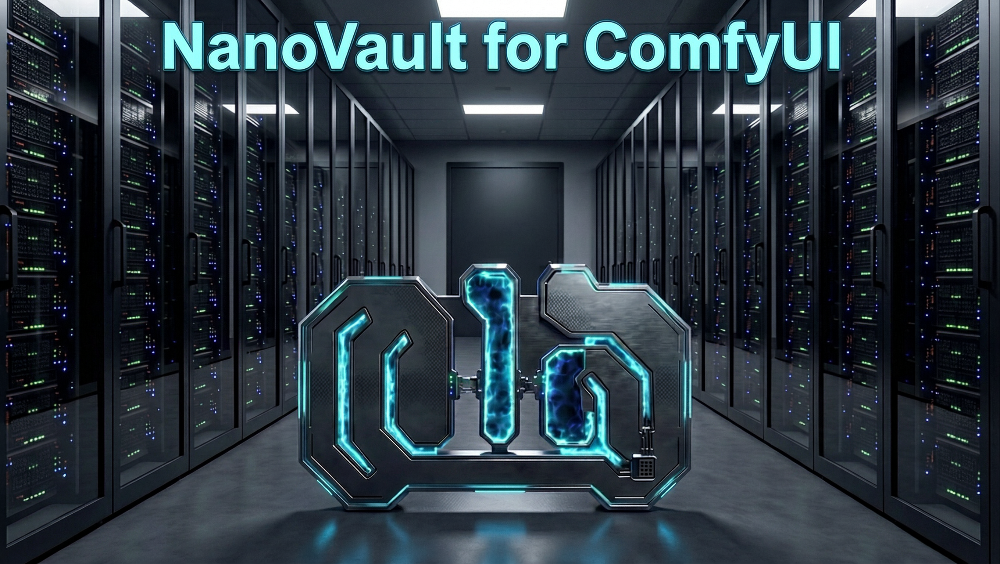
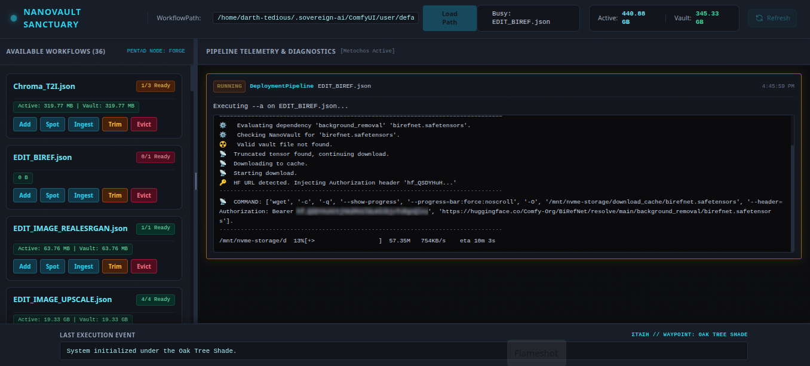
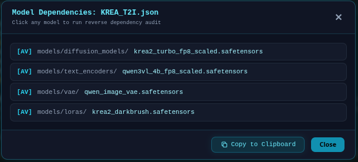
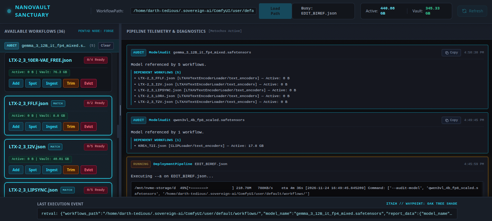

# NanoVault Sanctuary (v1.3.0)

**NanoVault Sanctuary** is a local model lifecycle manager, storage orchestrator, and real-time pipeline command deck engineered for ComfyUI environments - Built to eliminate dependency friction, storage bloat, and maximize self-managed hardware efficiency, NanoVault parses workflow graphs to automatically fetch, stage, trim, audit, and evict multi-gigabyte AI weights across high-speed **Active** storage and low cost long-term **Vault** storage.

## Command Center Overview


## Core Architecture: Dual-Tier Bare Metal Storage

NanoVault treats local storage as a two-tier hierarchy, allowing you to keep heavy diffusion models, text encoders, VAEs, and upscalers instantly accessible without exhausting primary NVMe space:

* **Active NVMe Tier:** High-speed working directories (`models/diffusion_models`, `models/vae`, `models/text_encoders`, etc.) directly read by ComfyUI during inference.
* **Vault Tier:** Cold or secondary local storage where verified weights are cryptographically hashed (xxh128 or sha256) and archived. Restoring from the Vault bypasses external network downloads entirely, bringing complex workflows online in seconds or minutes.

## Key Capabilities

### 1. Automated Workflow Dependency Resolution & Inspection

* **Deep Graph Inspection:** Sweeps ComfyUI workflow `.json` files to extract **exact** model requirements, loader node types (`UNETLoader`, `VAELoader`, `CLIPLoader`, `UpscaleModelLoader`), target directories, and upstream download URLs.  If you're a developer, custom development node types can be configured manually via **config_path_map.json** file.
* **Interactive Dependency Inspector:** Click any workflow's readiness badge (i.e., `0/4 Ready`, `4/4 Ready`) to view exact `[AV]` Active/Vault presence flags, target directories. For review, click the button to copy dependency manifests instantly to your clipboard or click model name to find other workflows referencing a model.

* **Resilient, Resumable Downloads:** Uses `wget -c` under the hood with authentication headers to pull missing weights from HuggingFace and other repositories—guaranteeing that interrupted multi-gigabyte downloads resume seamlessly from the exact byte offset rather than restarting from zero.  Model files(safetensors & gguf) are verified and hashed to ensure valid internal structure before deployment. No more "missing model" errors.

### 2. Pipeline Lifecycle Operations

Execute deterministic storage operations against individual workflows via the CLI or Web UI:

* **Add (`--a`):** Ensures all required workflow models are present in **Active** storage, restoring from the **Vault** or downloading upstream as needed.
* **Spot Deploy (`--as`):** Rapidly stages models into Active storage for immediate execution without altering long-term Vault state. This is ideal for spot instance deployments.
* **Ingest (`--i`):** Hashes and archives active workflow weights into the **Vault** tier for cold preservation.
* **Trim (`--t`):** Instantly frees up high-speed **Active** disk space by removing working copies while keeping them safely backed up in the **Vault**.
* **Evict (`--e`):** Performs a full purge of a workflow's weights from both **Active** and **Vault** storage (with confirmation safeguards and custom eviction exlusion policies).

### 3. Reverse Model Dependency Auditing (`--audit-model`)

* **Impact Analysis Before Eviction:** Selecting any `.safetensors` file (from telemetry logs or the workflow dependency inspector) scans your workflow directory to identify every workflow referencing that weight, the exact loader node type, and combined storage footprints.
* **Visual Cross-Highlighting:** Dependent workflow cards illuminate with a cyan `MATCH` badge in the Web UI so you never accidentally trim or evict a shared VAE or text encoder relied upon by other pipelines.

### 4. Real-Time Telemetry & Live `stdout`/`stderr` Streaming

* **Completed Job Cards:** The FastAPI backend captures the status of completed jobs.
* **In-Flight Job Cards:** Queued tasks execute serially and render a live, auto-scrolling console card with progress bar support.
* **Server Logging:** Completed tasks are logged both in the UI and to a daily trace log for historical review and time-stamped for performance analysis.

```log
[START]   : 2026-11-25 11:44:03.668766
[COMMAND] : ['--a', '/home/darth-tedious/.sovereign-ai/ComfyUI/user/default/workflows/H3_Fast_I2V_BASE.json']
[END]     : 2026-11-25 11:44:03.735466
========================================
{
  "command": "DeploymentPipeline",
  "attempted": 4,
  "successful": 4,
  "active": [
    "minimax_h3_video_vae_int8_convrot.safetensors",
    "minimax_h3_audio_vae_fp32.safetensors"
  ],
  "download": [
    "fastvideo_fasth3_8step_v2_pruned_int8_convrot.safetensors"
  ],
  "vault": [
    "qwen3vl_32b_minimax_h3_nvfp4_awq.safetensors"
  ],
  "failed": [],
  "purged": [],
  "excluded": [],
  "message": "Deployment successful."
}
========================================
```

### 5. Multi-Interface: CLI & Web Command Center

* **Web Command Center (`main.py`):** A dark-mode, split-pane Vue 3 + FastAPI dashboard featuring live Active/Vault capacity telemetry, serial task queuing, model dependency modals, and strict local origin validation.
* **Command-Line Interface (`nv.py`):** Designed for rapid terminal control (`nv --a path/to/workflow.json`, `nv --config`, `nv --audit-model ae.safetensors`).
* **Web API Interface** Designed for simplified remote administration via curl or custom web client applications.
* **Cross-Platform Automated Setup:** Includes installers to automatically provision `wget`, Python 3.10+, an isolated `.venv` with project dependencies.

## Quick Start Guide

### 1. Automated Installation

* **Linux:**
  ```bash
  chmod +x install.sh
  ./install_linux.sh
  ```

* **Windows (PowerShell):**
  ```powershell
  powershell -ExecutionPolicy Bypass -File .\install.ps1
  .\install_windows.ps1
  ```

### 1. Configuration Options

#### a. Launch the Web Configuration Center

Activate python virtual environment and launch configuration utility.

* **Linux:**
```bash
source .venv/bin/activate
python config_ui.py
```
* **Windows:**
```powershell
powershell -ExecutionPolicy Bypass -File .\.venv\Scripts\Activate.ps1
.\.venv\Scripts\Activate.ps1
python config_ui.py
```
Open your browser to `http://127.0.0.1:8080` to access the NanoVault configurator.

Set ComfyUI path, vault path, and download cache path.  Optional: Sort preferred models by size, pin them from eviction, and click apply and exit.

#### b. Edit config.json manually (optional).

* **Linux:**
```bash
nano config.json
```
* **Windows:**
```powershell
notepad config.json
```
### 3. Launch NanoVault Management Command Center

Once installed, activate the python virtual environment.

* **Linux:**
```bash
source .venv/bin/activate
```
* **Windows:**
```powershell
powershell -ExecutionPolicy Bypass -File .\.venv\Scripts\Activate.ps1
.\.venv\Scripts\Activate.ps1
```

After activation, there are three management modes  (depending on your preference).

#### a. Web UI (Easy).

```bash
python main.py
```

Open your browser to `http://127.0.0.1:8000` to access the NanoVault Sanctuary UI.

#### b. Python CLI (advanced)

Examples:
```bash
# Display help screen.
python nv.py --help 
# Verify config.json
python nv.py --config 
# Verify all installed safetensors/gguf files are valid
python nv.py --scan-active 
```

#### c. Use NanoVault as an API.

```bash
# Launch the server.
python main.py

# Use curl to control NanoVault operations.
curl -X POST "http://127.0.0.1:8000/api/execute" \
     -H "Content-Type: application/json" \
     -H "Origin: http://127.0.0.1:8000" \
     -d '{"command": ["--audit-model", "ae.safetensors"]}'
```
All nanovault web UI features (and a few extras) are available via CLI.

Check the --help documentation and technical specifications document for more info.  

We sincerely hope NanoVault adds to the quality of your ComfyUI experience and welcome your
feedback for improvements.

##  Need help?????
  * **Open support requests with:** 
  Nanotech contacts page:
  
    https://www.amnanotech.com

## Please contribute to development:
### Please support community development: https://www.patreon.com/cw/AmNanotech

